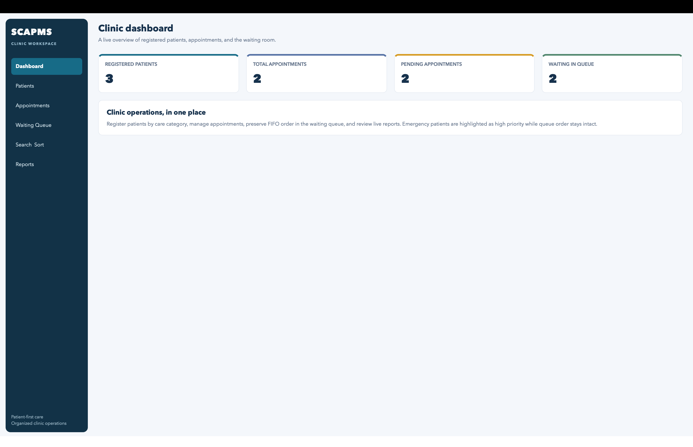
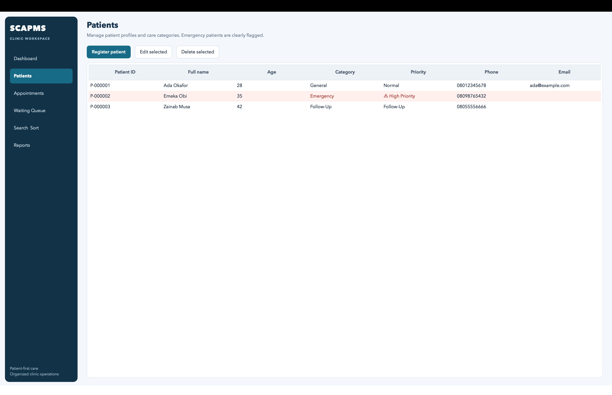
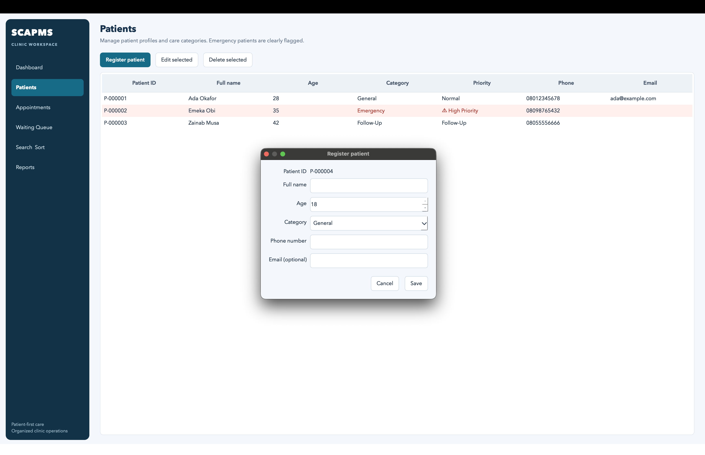
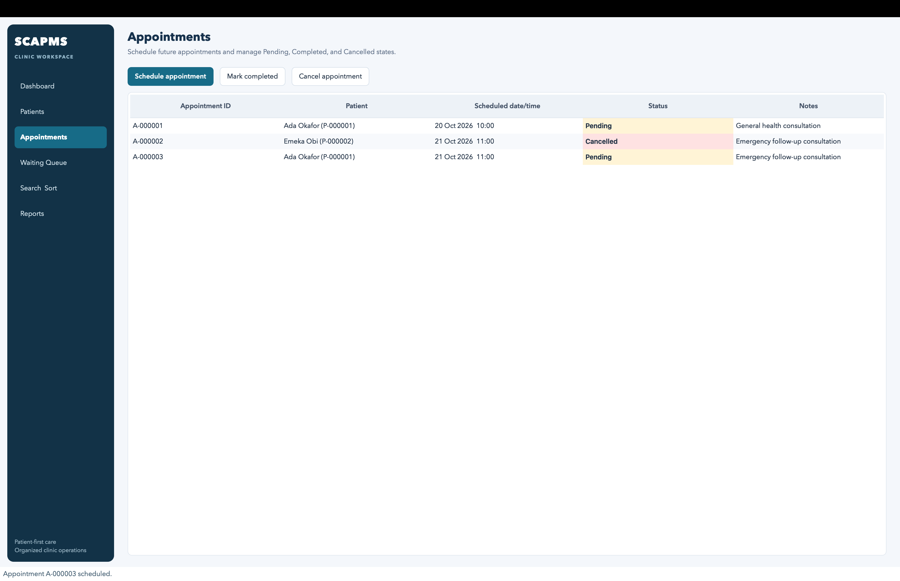
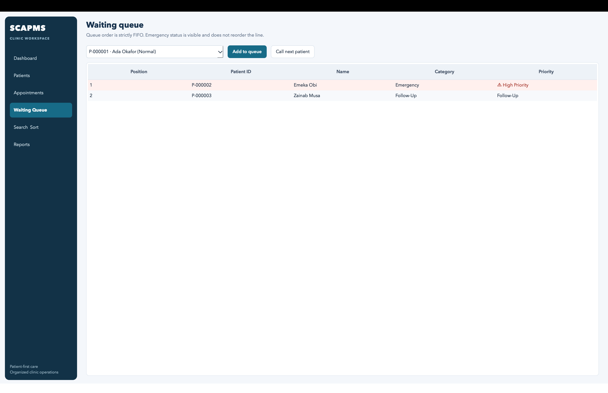
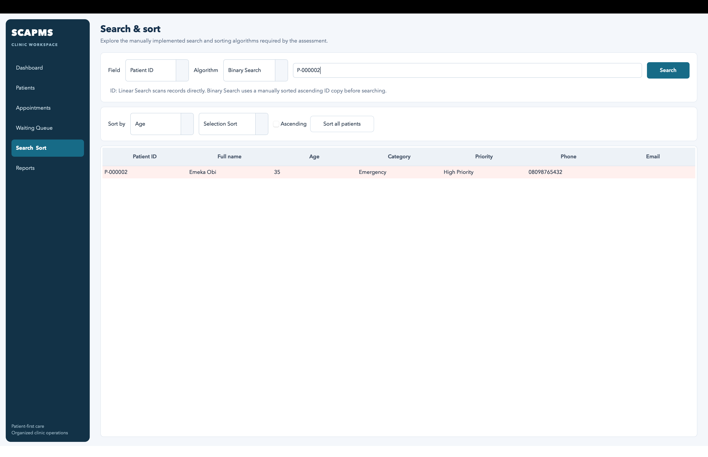
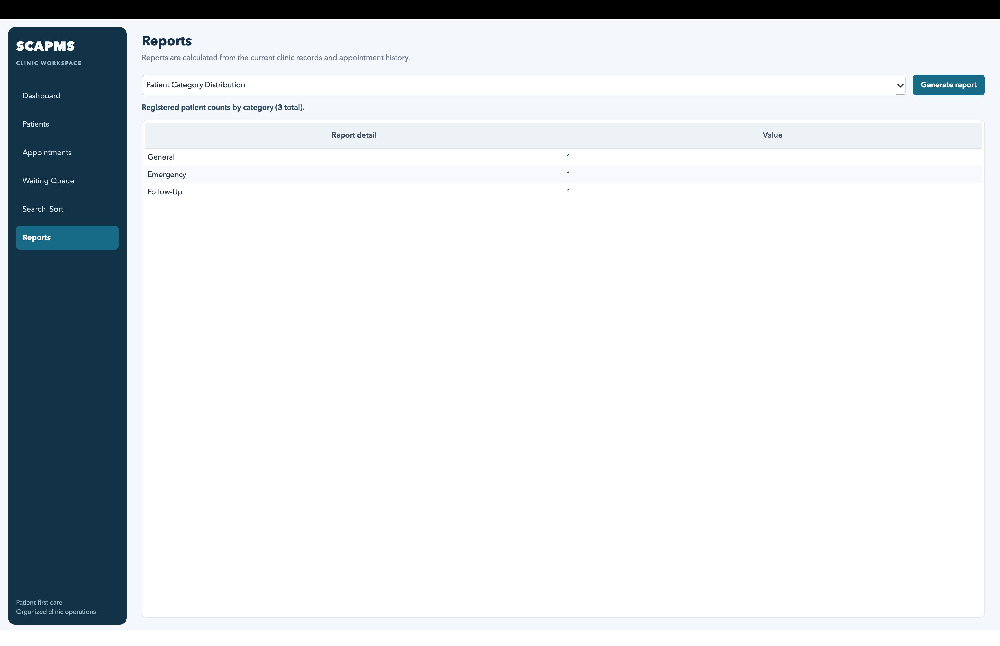
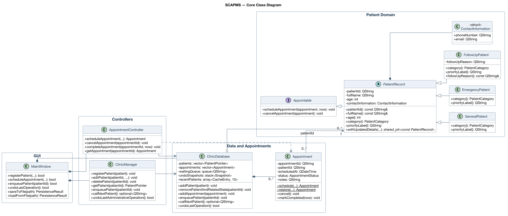

# Smart Clinic Appointment & Patient Management System (SCAPMS)

A C++17 desktop application for managing clinic patients, appointments, waiting queues, and reports. Built with **Qt 6 Widgets**, the project demonstrates object-oriented programming, data structures, searching and sorting algorithms, exception handling, and JSON-based data persistence.

Developed as part of the **COS 202 — Computer Programming II** lab assessment at Miva Open University.

## Overview

SCAPMS provides a graphical interface for handling everyday clinic administration tasks. It allows clinic staff to maintain patient records, organize appointments, manage a waiting queue, and generate reports from stored information.

The application is organized into six main sections:

- **Dashboard:** View a summary of patients, appointments, and waiting queue activity.
- **Patients:** Register, edit, delete, and view patient records.
- **Appointments:** Schedule appointments, update their status, and cancel appointments.
- **Waiting Queue:** Add patients to a first-in-first-out queue and call the next patient.
- **Search & Sort:** Find patient records and organize them using manually implemented algorithms.
- **Reports:** Generate summaries of clinic activity.

## Features

### Patient Management
- Register general, emergency, and follow-up patients.
- Edit and delete existing patient records.
- Validate patient information and generate unique patient IDs.
- Display patient categories and highlight emergency patients.

### Appointment Management
- Schedule appointments for registered patients.
- Track pending, completed, and cancelled appointments.
- Validate appointment dates and status changes.
- Maintain appointment records associated with patient IDs.

### Waiting Queue
- Enqueue patients in first-in-first-out (FIFO) order.
- Call the next patient in the queue.
- Prevent duplicate queue entries.
- Display patient queue positions.

### Searching and Sorting
- Linear search by patient ID.
- Binary search on patient records sorted by ID.
- Recursive search by patient name.
- Insertion Sort and Selection Sort.
- Sort patients by name, ID, or age in ascending or descending order.

### Reports
- Most frequently attended patients, based on completed appointments.
- Patients with pending appointments.
- Patient distribution by category.
- Daily appointment summary.

### Additional Functionality
- Undo supported administrative operations using saved state snapshots.
- Save and load clinic records as JSON files.
- Validate user input and display error messages.
- Preserve data integrity when loading or saving files.

## Application Screenshots

### Dashboard


### Patient Management


### Patient Registration


### Appointment Management


### Waiting Queue


### Search and Sort


### Reports


## Technology Stack

| Technology | Purpose |
|---|---|
| C++17 | Application logic and object-oriented programming |
| Qt 6 Widgets | Desktop graphical user interface |
| Qt Core | Core utilities and JSON support |
| CMake 3.21+ | Build configuration |
| C++ STL | Vectors, queues, stacks, arrays, and smart pointers |
| Qt Test / CTest | Automated testing |
| PlantUML | UML class diagrams |

## Architecture and OOP Design

SCAPMS separates its user interface, business logic, data storage, and persistence responsibilities.

The main components include:

- **Models:** Patient records, patient categories, appointments, and contact information.
- **Controllers:** Patient administration, appointment operations, searching, sorting, and reporting.
- **Database:** In-memory patient and appointment collections, waiting queue, undo history, and patient cache.
- **GUI:** Qt Widgets pages, dialogs, and event handlers.
- **Persistence:** JSON serialization, validation, saving, and loading.
- **Utilities:** Domain-specific exception handling.

### Object-Oriented Programming Concepts

**Abstraction:** `PatientRecord` defines a common abstract representation of patients, while `Appointable` defines appointment-related operations.

**Inheritance:** `GeneralPatient`, `EmergencyPatient`, and `FollowUpPatient` extend the patient model with category-specific behavior.

**Polymorphism:** Patient records are accessed through the abstract base type, allowing category-specific operations to be selected at runtime.

**Encapsulation:** Model fields are private, and validated methods control access and updates.

### UML Class Diagram



For the complete architecture, see the [detailed UML diagram](docs/submission-assets/domain-model.svg).

PlantUML source files are also available:

- [Simplified UML source](docs/domain-model-simplified.puml)
- [Detailed UML source](docs/domain-model.puml)

## Data Structures and Algorithms

The application uses the following data structures:

| Data Structure | Usage |
|---|---|
| `std::vector` | Stores patient and appointment records |
| `std::queue` | Maintains FIFO patient waiting order |
| `std::stack` | Stores snapshots for undo operations |
| `std::array` | Implements a fixed-size cache of 10 recently accessed patient IDs |
| `std::shared_ptr` | Manages shared ownership of patient records |

Searching and sorting algorithms are implemented manually for educational purposes.

| Algorithm | Purpose | Time Complexity |
|---|---|---|
| Linear Search | Find a patient by ID | O(n) |
| Binary Search | Find a patient by ID in sorted records | O(log n) |
| Recursive Search | Find patients by partial name | O(n) |
| Insertion Sort | Sort patient records | O(n²) worst case |
| Selection Sort | Sort patient records | O(n²) |

Binary Search requires patient records to be sorted by ID in ascending order.

## Getting Started

### Prerequisites

- macOS with a graphical desktop environment
- C++17-compatible compiler
- CMake 3.21 or newer
- Qt 6 (Core, Widgets, and Test)

The project has been built and tested on **macOS Apple silicon using Apple Clang and Qt 6.12.0**. Other platforms have not been verified.

### 1. Clone the Repository

```bash
git clone https://github.com/Chisomnwa/smart-clinic-management-system.git
cd smart-clinic-management-system
```

### 2. Install Dependencies

Using Homebrew:

```bash
brew install cmake qtbase
```

### 3. Configure the Project

```bash
cmake -S . -B build -DCMAKE_PREFIX_PATH="$(brew --prefix qtbase)"
```

### 4. Build the Application

```bash
cmake --build build --parallel
```

### 5. Run SCAPMS

```bash
./build/scapms
```

The application will open as a Qt desktop window.

## Running Tests

SCAPMS includes automated tests for the main application components.

Run all tests with:

```bash
ctest --test-dir build --output-on-failure
```

The four test suites are:

- `domain_models` — Patient and appointment model behavior.
- `phase3_features` — Clinic operations, data structures, and algorithms.
- `persistence` — JSON saving, loading, and validation.
- `gui_integration` — Qt GUI behavior and integration.

All four suites passed in the final verified project build.

## Project Structure

```text
smart-clinic-management-system/
├── models/              # Patient and appointment models
├── controllers/         # Clinic operations, algorithms, reports
├── data/                # Database and STL containers
├── gui/                 # Qt Widgets interface
├── persistence/         # JSON save/load implementation
├── utils/               # Domain exceptions
├── tests/               # Automated tests and fixtures
├── docs/                # Assessment, UML, and visual assets
│   └── submission-assets/
│       └── screenshots/
├── CMakeLists.txt        # CMake build configuration
└── README.md             # Project documentation
```

## Validation and Data Persistence

SCAPMS uses domain-level validation to reject invalid operations, including missing required patient details, duplicate identifiers, invalid appointment dates, and inconsistent queue or appointment states.

The application saves clinic records in JSON format. Loading validates a candidate dataset before replacing the active records, while saving uses Qt's `QSaveFile` mechanism for atomic file replacement.

A custom `DomainException` class supports meaningful error handling, and the GUI displays errors through user-facing dialogs.

## Project Context

This application was developed for the **COS 202 — Computer Programming II** lab assessment at **Miva Open University**.

The project demonstrates the integration of object-oriented programming, STL containers, recursion, searching and sorting algorithms, event-driven GUI programming, file handling, and automated testing in a functional desktop application.

## Author

**Chisom Nnamani**

B.Sc. Computer Science  
Miva Open University

GitHub: [@Chisomnwa](https://github.com/Chisomnwa)